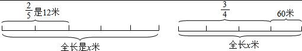

# Mathematics (Grade 6)

**ID**: b8f04ed4
**难度**: hard
**题型**: short_answer

## 题目
根据线段图列方程解答，然后求出未知数x的值．

## 解答

**答案**: 30, 240

1. Step1:对于第一个线段图，把全长设为x米，因为全长的$\frac{2}{5}$是12米，所以列出方程$\frac{2}{5}$x = 12
2. Step2:求解方程$\frac{2}{5}$x = 12，方程两边同时除以$\frac{2}{5}$，得到x = 12÷$\frac{2}{5}$ = 30
3. Step3:对于第二个线段图，把全长设为x米，因为60米是全长的(1 - $\frac{3}{4}$，所以列出方程(1 - $\frac{3}{4}$x = 60
4. Step4:先计算1 - $\frac{3}{4}$ = $\frac{1}{4}$，方程变为$\frac{1}{4}$x = 60
5. Step5:求解方程$\frac{1}{4}$x = 60，方程两边同时除以$\frac{1}{4}$，得到x = 60÷$\frac{1}{4}$ = 240

## 知识点

**知识点**:
  - 分数除法应用题

---
