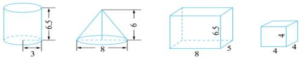

# Mathematics (Grade 6)

**ID**: b996a9fc
**难度**: hard
**题型**: short_answer

## 题目
求下面图形的体积．（单位：厘米）

## 解答

**答案**: 183.69, 100.48, 260, 64

1. Step1:根据圆柱体积公式V=Sh（S为底面积，h为高），底面积S = 3.14×3²，高为6.5，可得体积为3.14×3²×6.5 = 3.14×9×6.5 = 183.69立方厘米
2. Step2:根据圆锥体积公式V=$rac{1}{3}$Sh，底面半径为8÷2 = 4，底面积S = 3.14×4²，高为6，可得体积为$rac{1}{3}$×3.14×（8÷2）²×6 = $rac{1}{3}$×3.14×16×6 = 3.14×16×2 = 100.48立方厘米
3. Step3:根据长方体体积公式V=abh，长为8，宽为5，高为6.5，可得体积为8×5×6.5 = 40×6.5 = 260立方厘米
4. Step4:根据正方体体积公式V=a³，棱长为4，可得体积为4×4×4 = 16×4 = 64立方厘米

## 知识点

**知识点**:
  - 圆锥的体积;圆柱的侧面积、表面积和体积

---
