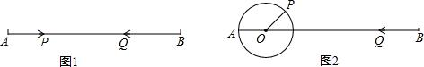

# Mathematics (Grade 6)

**ID**: bb2916a8
**难度**: hard
**题型**: short_answer

## 题目
已知：线段AB=60cm．
（1）如图1，点P沿线段AB自A点向B点以4厘米/分运动，点Q沿线段BA自B点以6厘米/分运动，问经过几分后P、Q相遇？
（2）几分钟后，P、Q两点相距20厘米？
（3）如图2，AO=PO=8厘米，∠POB=40°，现将点P绕着点O以20度/分的速度顺时针旋转一周后停止，同时点Q沿直线BA沿B点向A点运动，假若P、Q两点也能相遇，求点Q的速度．

## 解答

**答案**: 6, 4, 8, 22, $\frac{60}{11}$

1. Step1:根据相遇问题公式'时间=路程÷速度'，计算P、Q相遇时间，即60÷(4 + 6)=6（分钟）
2. Step2:计算PQ未相遇时相距20厘米的时间，即(60 - 20)÷(4 + 6)=4（分钟）
3. Step3:计算PQ相遇后相距20厘米的时间，即(60 + 20)÷(4 + 6)=8（分钟）
4. Step4:计算点P旋转40°到线段AB上的时间为40÷20 = 2（分钟），此时P、Q间距离为60 - 8×2 = 44厘米，点Q速度为44÷2 = 22（厘米/分钟）
5. Step5:计算点P旋转到A的位置的时间为(40 + 180)÷20 = 11（分钟），此时P、Q间距离为60厘米，点Q速度为60÷11 = $\frac{60}{11}$（厘米/分钟）

## 知识点

**知识点**:
  - 有关圆的应用题

---
