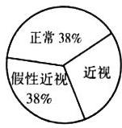

# Mathematics (Grade 6)

**ID**: bb6b468a
**难度**: hard
**题型**: short_answer

## 题目
下图是某小学六年级学生视力情况统计图根据扇形图完成下列各题．

 正常38%  假性近视38%  近视
 (1)近视人数占六年级学生人数的百分比是多少？视力不良（包括假性近视）的人数占六年级学生人数的百分比是多少？
 (2)视力正常的有76人，六年级共有多少人？视力不良的有多少人？
 (3)通过上面两小题，面对这个学校六年级学生的视力状况，你有什么想法和好的建议？

## 解答

**答案**: 24%, 62%, 200, 124, 同学们的视力太差，应注意保护眼睛，爱护眼睛．

1. Step1:把六年级学生总人数看作单位'1'，计算近视人数占六年级学生人数的百分比，即1 - 38% - 38% = 24%
2. Step2:计算视力不良（包括假性近视）的人数占六年级学生人数的百分比，即38% + 24% = 62%
3. Step3:已知视力正常的有76人，且视力正常人数占六年级总人数的38%，计算六年级总人数，即76÷38% = 200人
4. Step4:已知六年级总人数为200人，视力不良人数占六年级学生人数的62%，计算视力不良的人数，即200×62% = 124人
5. Step5:得出面对这个学校六年级学生视力状况的想法和建议为同学们的视力太差，应注意保护眼睛，爱护眼睛．

## 知识点

**知识点**:
  - --

---
