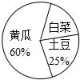

# Mathematics (Grade 6)

**ID**: bdf305ea
**难度**: hard
**题型**: short_answer

## 题目
如图是某蔬菜基地去年蔬菜种植情况示意图：
（1）已知白菜的种植面积是30公顷，三种蔬菜去年的种植总面积是多少公顷？
（2）今年土豆的种植面积比去年减少了40%，今年土豆的种植面积是多少公顷？

## 解答

**答案**: 200, 30

1. Step1:根据扇形统计图可知，白菜种植面积占比为1 - 60% - 25% = 15%，已知白菜种植面积是30公顷，根据已知一个数的百分之几是多少求这个数，用除法，所以三种蔬菜去年的种植总面积为30÷15% = 30÷0.15 = 200公顷
2. Step2:由上一步已求出去年种植总面积为200公顷，去年土豆种植面积占比25%，所以去年土豆种植面积为200×25% = 200×0.25 = 50公顷
3. Step3:已知今年土豆的种植面积比去年减少了40%，那么今年土豆种植面积是去年的1 - 40% = 60%，所以今年土豆的种植面积为50×60% = 50×0.6 = 30公顷

## 知识点

**知识点**:
  - 扇形统计图

---
