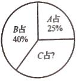

# Mathematics (Grade 6)

**ID**: bf567735
**难度**: hard
**题型**: short_answer

## 题目
超市销售A，B，C三种饮料，第二季度A，B，C三种饮料的销售量如图。已知A种饮料比B种饮料少销售18000箱。
（1）三种饮料共销售了多少箱？
（2）C种饮料销售了多少箱？

## 解答

**答案**: 120000箱, 42000箱

1. Step1:根据已知条件，A种饮料比B种饮料少销售18000箱，A占25%，B占40%，所以先计算18000÷（40%－25%），即18000÷0.15，得到三种饮料共销售的箱数为120000箱
2. Step2:已知三种饮料共销售120000箱，C种饮料占比为1－40%－25% = 35%，即0.35，所以计算120000×0.35，得到C种饮料销售的箱数为42000箱

## 知识点

**知识点**:
  - 小学数学;统计和概率;统计;统计图;扇形统计图的特点及绘制;统计图表的综合应用

---
