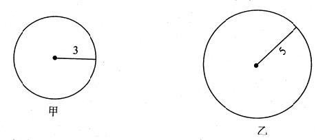

# Mathematics (Grade 6)

**ID**: c1051610
**难度**: hard
**题型**: short_answer

## 题目
看图完成下面各题。（单位：厘米）

（1）甲圆和乙圆周长的比是多少？
（2）甲圆和乙圆面积的比是多少？

## 解答

**答案**: 3:5, 9:25

1. Step1:根据圆的周长公式C = 2πr，计算甲圆周长为3.14×2×3
2. Step2:根据圆的周长公式C = 2πr，计算乙圆周长为3.14×2×5
3. Step3:计算甲圆周长与乙圆周长的比为(3.14×2×3):(3.14×2×5)，化简得到3:5
4. Step4:根据圆的面积公式S = πr²，计算甲圆面积为3.14×3²
5. Step5:根据圆的面积公式S = πr²，计算乙圆面积为3.14×5²
6. Step6:计算甲圆面积与乙圆面积的比为(3.14×3²):(3.14×5²)，化简得到9:25

## 知识点

**知识点**:
  - 圆的周长;圆的面积

---
