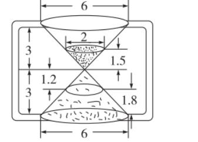

# Mathematics (Grade 6)

**ID**: c1859241
**难度**: hard
**题型**: short_answer

## 题目
如图，儿童玩具沙漏是仿照我国古代计时仪器沙钟的原理制成的。（单位：cm）

（1）这时沙漏上部剩余的沙子体积是多少立方厘米？
（2）这时沙漏下部沙子的体积是多少立方厘米？

## 解答

**答案**: 1.57, 26.45136

1. Step1:根据解析2，对于沙漏上部剩余沙子体积，其底面半径为2÷2 = 1cm，高为1.5cm，根据圆锥体积公式V = $rac{1}{3}$πr²h，可得体积为$rac{1}{3}$×3.14×1²×1.5 = 1.57cm³
2. Step2:对于沙漏下部沙子体积，设下部分上底面半径为xcm，根据相似关系3:6 = 1.2:2x，解此比例式，6x = 7.2，得出x = 1.2cm
3. Step3:根据圆锥体积公式，先计算大圆锥体积为$rac{1}{3}$×3.14×(6÷2)²×3 = 28.26cm³
4. Step4:再计算小圆锥体积为$rac{1}{3}$×3.14×1.2²×1.2 = 1.80864cm³
5. Step5:用大圆锥体积减去小圆锥体积，即28.26 - 1.80864 = 26.45136cm³，得到沙漏下部沙子体积

## 知识点

**知识点**:
  - 解比例;圆锥的体积

---
