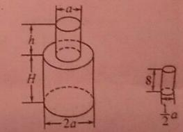

# Mathematics (Grade 6)

**ID**: c26b8513
**难度**: hard
**题型**: short_answer

## 题目
如图，将第1个瓶子装满水，如果将这个瓶子中的水全部倒入第2个杯子里，那么需要多少个这样的杯子？

 a h H 2a 8
 $\frac{1}{2}a$

## 解答

**答案**: 2H+0.5h

1. Step1:根据圆柱体体积公式，计算第1个瓶子体积为πa²⋅H+π(1/2*a)²⋅h
2. Step2:对第1个瓶子体积表达式化简，得到a²πH + 1/4*a²πh=a²π(H + 1/4*h)
3. Step3:根据圆柱体体积公式，计算第2个瓶子体积为π⋅(1/4*a)²⋅8 = 1/2*a²π
4. Step4:用第1个瓶子体积除以第2个瓶子体积，即a²π(H + 1/4*h)÷1/2*a²π
5. Step5:对a²π(H + 1/4*h)÷1/2*a²π进行计算，得到(H + 1/4*h)×2
6. Step6:展开(H + 1/4*h)×2，得到2H + 1/2*h

## 知识点

**知识点**:
  - --

---
