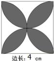

# Mathematics (Grade 6)

**ID**: c4b1d865
**难度**: hard
**题型**: short_answer

## 题目
如图：正方形边长是4厘米，以四边为直径在正方形内部画了四个半圆，求阴影部分的面积（保留整数）．

## 解答

**答案**: 9.12

1. Step1:计算正方形的面积，根据正方形面积公式S=a²（a为边长），可得4×4 = 16平方厘米
2. Step2:计算一个半圆的半径，由直径是4厘米，可得半径r = 4÷2 = 2厘米
3. Step3:计算两个半圆的面积，也就是一个整圆的面积，根据圆的面积公式S = πr²，可得3.14×2² = 12.56平方厘米
4. Step4:计算两个空白处的面积，用正方形面积减去一个整圆的面积，即16 - 12.56 = 3.44平方厘米
5. Step5:计算四个空白处的面积，因为两个空白处面积是3.44平方厘米，所以四个空白处面积是3.44×2 = 6.88平方厘米
6. Step6:计算阴影部分的面积，用正方形面积减去四个空白处的面积，即16 - 6.88 = 9.12平方厘米

## 知识点

**知识点**:
  - 圆与组合图形

---
