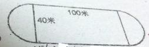

# Mathematics (Grade 6)

**ID**: c67d19b9
**难度**: hard
**题型**: short_answer

## 题目
如图，有一个操场，现在要在操场的外围铺设4条宽度为1米的塑胶跑道，塑胶每平方米35元，铺塑胶跑道一共要多少元？

## 解答

**答案**: 43825.6

1. Step1:计算两条直跑道的面积，直跑道长100米，宽为4条1米宽即4米，所以两个直跑道面积为100×4×2 = 800平方米
2. Step2:计算去掉塑胶跑道后小圆的直径，40 - 4×2 = 32米
3. Step3:计算原来大圆的面积，半径为40÷2 = 20米，面积为3.14×（40÷2）² = 3.14×400 = 1256平方米
4. Step4:计算去掉塑胶跑道后小圆的面积，半径为32÷2 = 16米，面积为3.14×（32÷2）² = 3.14×256 = 803.84平方米
5. Step5:计算两个弯道的面积，为大圆面积减去小圆面积，即3.14×（40÷2）² - 3.14×（32÷2）² = 1256 - 803.84 = 452.16平方米
6. Step6:计算外围跑道的总面积，为直跑道面积与弯道面积之和，800 + 452.16 = 1252.16平方米
7. Step7:计算铺塑胶跑道的总费用，总面积乘每平方米单价，1252.16×35 = 43825.6元

## 知识点

**知识点**:
  - 圆、圆环的面积

---
