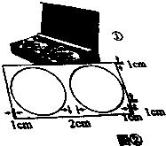

# Mathematics (Grade 6)

**ID**: c6fe86d3
**难度**: hard
**题型**: short_answer

## 题目
一种普洱茶茶饼，底面直径是18cm，高2cm，现要做一种礼盒（如图①），要求能装下两个这样的茶饼．盒子装下茶饼后，四周各留空1cm，两个茶饼间留空2cm（如图②），求做100个这样的礼盒至少需要多少平方米的硬纸板（纸板的厚度忽略不计）？

## 解答

**答案**: 18.4

1. Step1:计算礼盒的长，长为两个茶饼底面直径加上两个茶饼间留空以及两边各留空的长度，即 1+2+1+18+18 = 40 厘米
2. Step2:计算礼盒的宽，宽为一个茶饼底面直径加上两边各留空的长度，即 1+1+18 = 20 厘米
3. Step3:确定礼盒的高为茶饼的高 2 厘米
4. Step4:根据长方体表面积公式 S = 2(ab + ah + bh)，其中 a = 40 厘米，b = 20 厘米，h = 2 厘米，计算一个礼盒的表面积，即(40×20 + 40×2 + 20×2)×2 = (800 + 80 + 40)×2 = 920×2 = 1840 平方厘米
5. Step5:计算 100 个礼盒的总面积，1840×100 = 184000 平方厘米
6. Step6:将总面积的单位换算为平方米，184000 平方厘米 = 18.4 平方米

## 知识点

**知识点**:
  - 长方体、正方体表面积与体积计算的应用

---
