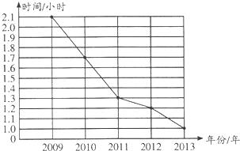

# Mathematics (Grade 6)

**ID**: cc0e60dc
**难度**: hard
**题型**: short_answer

## 题目
根据下面的统计图回答问题．
某学校四年级学生人均课外阅读时间变化情况统计图
（1）2013年该校四年级学生人均课外阅读时间比2009年少多少时间？
（2）该校四年级学生人均课外阅读时间呈现什么变化趋势？
（3）你还能提出什么数学问题？

## 解答

**答案**: 1.1（小时）, 下降趋势, $\frac{3}{7}$

1. Step1:观察统计图可知2009年该校四年级学生人均课外阅读时间为2.1小时，2013年为1.0小时，用2009年的时间减去2013年的时间，即2.1 - 1.0 = 1.1小时，得到2013年该校四年级学生人均课外阅读时间比2009年少1.1小时
2. Step2:观察统计图的折线走向，可知该校四年级学生人均课外阅读时间呈现下降趋势
3. Step3:提出问题“2012年该校四年级学生人均课外阅读时间比2009年少几分之几”，先计算时间差2.1 - 1.2 = 0.9小时，再用时间差除以2009年的时间0.9÷2.1 = $\frac{3}{7}$

## 知识点

**知识点**:
  - 单式折线统计图；“提问题”、“填条件”应用题；从统计图表中获取信息．

---
