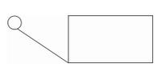

# Mathematics (Grade 6)

**ID**: cda631d4
**难度**: hard
**题型**: short_answer

## 题目
如图，长方形建筑物，一只狗拴在墙角处，不能够进入长方形内部，长方形长5米，宽为4米，绳子长6米，求出小狗活动的范围有多少平方米?

## 解答

**答案**: 88.705

1. Step1:明确圆的面积公式为S = πr²，其中S表示圆的面积，r表示圆的半径
2. Step2:分析小狗活动范围的第一部分，是以绳长6米为半径的圆的面积的3/4，根据圆的面积公式可得这部分面积为3.14×6²×3/4
3. Step3:分析小狗活动范围的第二部分，是以绳长减去长方形长（6 - 5）米为半径的圆的面积的1/4，根据圆的面积公式可得这部分面积为3.14×(6 - 5)²×1/4
4. Step4:分析小狗活动范围的第三部分，是以绳长减去长方形宽（6 - 4）米为半径的圆的面积的1/4，根据圆的面积公式可得这部分面积为3.14×(6 - 4)²×1/4
5. Step5:将三部分面积相加，即3.14×6²×3/4 + 3.14×(6 - 5)²×1/4 + 3.14×(6 - 4)²×1/4 = 88.705，得到小狗活动的范围

## 知识点

**知识点**:
  - 圆的面积

---
