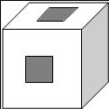

# Mathematics (Grade 6)

**ID**: d45d05ec
**难度**: hard
**题型**: short_answer

## 题目
在一个棱长为12厘米的正方体木块上面正中心的位置挖一个边长为5厘米的正方形洞和对面打通（如图所示），再从前面的正中心到后面挖通一个边长为5厘米的正方形的洞，这时表面积比最初的正方体木块的表面积增加了多少平方厘米？

## 解答

**答案**: 280

1. Step1:计算由于挖洞减少的表面积，减少的是4个边长为5厘米的正方形的面积，根据正方形面积公式S = a×a（a为边长），可得减少的面积为4×(5×5)=100平方厘米
2. Step2:计算由于挖洞增加的表面积，增加的是8个长12厘米宽5厘米的长方形的面积减去4个边长5厘米的正方形的面积，长方形面积公式为S = a×b（a为长，b为宽），则增加的面积为8×(12×5) - 4×(5×5)=480 - 100 = 380平方厘米
3. Step3:计算最终表面积增加的值，用增加的表面积减去减少的表面积，即380 - 100 = 280平方厘米

## 知识点

**知识点**:
  - 规则立体图形的表面积．

---
