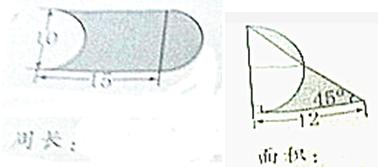

# Mathematics (Grade 6)

**ID**: d5c6b055
**难度**: hard
**题型**: short_answer

## 题目
求阴影部分的周长和面积．

## 解答

**答案**: 61.4, 25.74

1. Step1:根据解析2可知，求阴影部分周长需先明确其组成，阴影部分的周长=长方形的两条长+一个圆的周长，长方形长为15，圆的直径为10，根据圆的周长公式C = πd（d为直径），圆的周长为3.14×10，长方形两条长为15×2，所以周长为15×2 + 3.14×10 = 30 + 31.4 = 61.4
2. Step2:根据解析2可知，求阴影部分面积需先明确其组成，阴影部分的面积=梯形的面积 - $rac{1}{4}$圆的面积，先求梯形的高和圆的半径，由12÷2 = 6得到，再根据梯形面积公式S=(a + b)h÷2（a、b为上底和下底，h为高），梯形面积为(6 + 12)×6÷2 = 18×6÷2 = 54，根据圆的面积公式S = πr²（r为半径），$rac{1}{4}$圆的面积为$rac{1}{4}$×3.14×6² = $rac{1}{4}$×3.14×36 = 28.26，所以阴影部分面积为54 - 28.26 = 25.74

## 知识点

**知识点**:
  - 组合图形的面积

---
