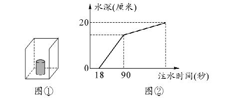

# Mathematics (Grade 6)

**ID**: d6ece0b0
**难度**: hard
**题型**: short_answer

## 题目
如图①，在底面积为100平方厘米，高为20厘米的长方体水槽内固定有一个圆柱形的杯子（杯壁厚度忽略不计）。现以恒定不变的流量速度先向杯子中注水，注满杯子后，继续注水，直到注满水槽为止。此过程中，水槽中水深随注水时间的变化关系如图②所示。根据题意及折线图提供的信息，解答下列问题：

（1）从折线图中可以看出，注水到第 $\underline{\hspace{5em}}$ 秒时，水杯刚刚装满水；注水到第 $\underline{\hspace{5em}}$ 秒时，水槽中的水刚刚把水杯淹没；
（2）通过计算，求出水杯的底面积；
（3）若水杯的高度为9厘米，请问注水的速度为每秒多少立方厘米？在水杯刚刚被淹没后，还需要多少秒可以把整个水槽注满？

## 解答

**答案**: 18, 90, 20, 10, 110

1. Step1:观察图②，当注水时间为18秒时，水深折线出现转折，说明此时水杯刚刚装满水；当注水时间为90秒时，水深折线再次出现变化趋势的改变，说明此时水槽中的水刚刚把水杯淹没，所以第一个空填18，第二个空填90
2. Step2:计算90 - 18 = 72秒，这是从水杯装满到水槽水刚好淹没水杯所用时间，72÷18 = 4，即从水杯装满到水槽水刚好淹没水杯这段时间的注水量是水杯注满时水量的4倍。因为在水杯高度对应的这部分，水槽和水杯的高度相同，根据体积公式V = Sh（S为底面积，h为高），高度相同情况下体积比等于底面积比，所以水槽底面积是水杯底面积的4 + 1 = 5倍，已知水槽底面积为100平方厘米，则水杯底面积为100÷5 = 20平方厘米
3. Step3:已知水杯高度为9厘米，水杯底面积为20平方厘米，根据圆柱体积公式V = Sh，可得水杯容积为20×9 = 180立方厘米，又已知注满水杯用时18秒，所以注水速度为180÷18 = 10立方厘米/秒
4. Step4:水槽高度为20厘米，水杯高度为9厘米，那么水杯被淹没后还需注水的高度为20 - 9 = 11厘米，水槽底面积为100平方厘米，所以还需注水的体积为100×11 = 1100立方厘米，已知注水速度为10立方厘米/秒，所以还需时间为1100÷10 = 110秒
5. Step5:整理答案为['18', '90', '20', '10', '110']

## 知识点

**知识点**:
  - 从统计图表中获取信息

---
