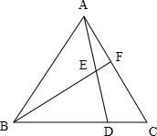

# Mathematics (Grade 6)

**ID**: d7bbbc9d
**难度**: hard
**题型**: short_answer

## 题目
如图，一个三角形ABC面积是25平方厘米，BD=2DC，AE=ED，问四边形CDEF的面积是多少？

## 解答

**答案**: $\frac{20}{3}$

1. Step1:连接CE，因为BD=2DC，所以根据三角形面积与底的关系，三角形ABD的面积为25×$rac{2}{3}$=$rac{50}{3}$平方厘米，三角形ACD的面积为25×$rac{1}{3}$=$rac{25}{3}$平方厘米
2. Step2:由于AE=ED，那么三角形ABE或BDE的面积为$rac{50}{3}$×$rac{1}{2}$=$rac{25}{3}$平方厘米，三角形CDE的面积为$rac{25}{3}$×$rac{1}{2}$=$rac{25}{6}$平方厘米
3. Step3:计算三角形ABE的面积与三角形BCE的面积比，三角形BCE的面积为$rac{25}{3}+rac{25}{6}$，则三角形ABE的面积：三角形BCE的面积=$rac{25}{3}$：（$rac{25}{3}+rac{25}{6}$）=2：3
4. Step4:根据燕尾定理，由三角形ABE的面积：三角形BCE的面积=2：3，可得AF：FC=2：3
5. Step5:计算AF与FC份数和为2+3=5，所以三角形BCF的面积为25×$rac{3}{5}$=15平方厘米
6. Step6:计算四边形CDEF的面积，用三角形BCF的面积减去三角形BDE的面积，即15 - $rac{25}{3}$=$rac{20}{3}$平方厘米

## 知识点

**知识点**:
  - 三角形面积与底的正比关系．

---
