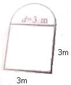

# Mathematics (Grade 6)

**ID**: d955042d
**难度**: hard
**题型**: short_answer

## 题目
小红家有5个同样大小的窗户，窗户的上面是半圆，下面是正方形．
（1）每个窗户的面积约是多少平方米？（得数保留一位小数）．
（2）如果制作这样的窗户每平方米需要工料费200元，那么制作5个窗户共要工料费多少元？

## 解答

**答案**: 12.5, 12500

1. Step1:计算半圆半径，3÷2 = 1.5（米）
2. Step2:计算半圆面积，3.14×1.5×1.5÷2 = 3.5325（平方米）
3. Step3:计算正方形面积，3×3 = 9（平方米）
4. Step4:计算每个窗户面积，3.5325 + 9 = 12.5325≈12.5（平方米）
5. Step5:计算5个窗户面积，12.5×5 = 62.5（平方米）
6. Step6:计算制作5个窗户的工料费，200×62.5 = 12500（元）

## 知识点

**知识点**:
  - 组合图形的面积

---
