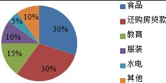

# Mathematics (Grade 6)

**ID**: dbede14b
**难度**: hard
**题型**: short_answer

## 题目
陈东家每月各种支出计划如图．
（1）你能得到哪些信息？
（2）如果陈东家每月总计支出2000元，你能提出并解决哪此问题？

## 解答

**答案**: 可以得到如下信息：通过这幅扇形统计图我们可以看出：陈东家每月支出所占的百分比，用还房贷与食品支出的所占的百分比相同，服装支出与其他支出所占的百分比相同，教育支出是水电费支出的3倍等．, 600（元）, 50%

1. Step1:观察扇形统计图，可知能得到陈东家每月支出中各项所占的百分比情况，比如还房贷与食品支出的所占的百分比相同，服装支出与其他支出所占的百分比相同，教育支出是水电费支出的3倍等信息，以此回答问题（1）
2. Step2:对于问题（2），提出“陈东家每月还房贷多少元”的问题，根据百分数乘法的意义，用每月总计支出2000元乘还房贷所占的30%，即2000×30% = 600元，得到每月还房贷的金额
3. Step3:提出“买服装比教育支出多百分之几”的问题，先计算服装支出与教育支出的百分比差值15% - 10% = 5%，再用差值除以教育支出的百分比，即5%÷10% = 50%，得到买服装比教育支出多的百分比

## 知识点

**知识点**:
  - 扇形统计图

---
