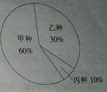

# Mathematics (Grade 6)

**ID**: dc282708
**难度**: hard
**题型**: short_answer

## 题目
某商场销售甲、乙、丙三种饮料，第三季度销售量的百分比如图．

 甲种60%    乙种30%    丙种10%
 （1）甲种饮料销售了12000瓶，三种饮料共销售了多少瓶？
 （2）乙种饮料和丙种饮料各销售了多少瓶？
 （3）丙种饮料比乙种饮料少销售了百分之几？

## 解答

**答案**: 20000, 6000, 1000, 83.3

1. Step1:根据甲种饮料销售数量和所占百分比求三种饮料总销售数量，即12000÷60%=20000
2. Step2:用总销售数量乘以乙种饮料所占百分比求乙种饮料销售数量，即20000×30%=6000
3. Step3:用总销售数量乘以丙种饮料所占百分比求丙种饮料销售数量，即20000×10%=1000
4. Step4:先求丙种饮料比乙种饮料少销售的数量为6000 - 1000 = 5000，再除以乙种饮料销售数量乘以100%求少销售的百分比，即5000÷6000×100%≈83.3%

## 知识点

**知识点**:
  - --

---
