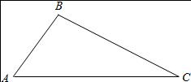

# Mathematics (Grade 6)

**ID**: def87f05
**难度**: hard
**题型**: short_answer

## 题目
如图所示，A，B，C三地之间有三条公路相连，三条公路的路程之比是AB：BC：AC=2：4：5．甲乙两车同时从A地出发，甲车沿A→B→C方向行驶，乙车沿A→C→B方向行驶，2$\frac{3}{4}$小时后在B地和C地之间的D地相遇．已知汽车沿A→B方向和C→B方向行驶的速度都是每小时60千米，沿B→C方向行驶的速度是每小时90千米，沿A→C方向行驶的速度是每小时75千米，求C、D两地之间的距离是多少千米？

## 解答

**答案**: 45

1. Step1:设AB为2a，BC为4a，CA为5a，CD为x千米
2. Step2:根据甲车行驶情况和相遇时间，列出方程$rac{2a}{60}$+$rac{4a−x}{90}$=2$rac{3}{4}$，化简得到6a + 8a - 2x = 495，进一步得到14a - 2x = 495
3. Step3:根据乙车行驶情况和相遇时间，列出方程$rac{5a}{75}$+$rac{x}{60}$=2$rac{3}{4}$，化简得到20a + 5x = 825，进而得出a = $rac{165−x}{4}$
4. Step4:将a = $rac{165−x}{4}$代入14a - 2x = 495，得到14×$rac{165−x}{4}$-2x = 495
5. Step5:求解方程14×$rac{165−x}{4}$-2x = 495，得出x = 45

## 知识点

**知识点**:
  - 环形跑道问题．

---
