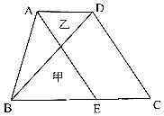

# Mathematics (Grade 6)

**ID**: e470d7dd
**难度**: hard
**题型**: short_answer

## 题目
梯形ABCD中，AE∥DC，甲的面积比乙的面积多5平方厘米，BE：EC=3：2，求梯形面积．

## 解答

**答案**: 25

1. Step1:因为BE：EC = 3：2，且三角形ABE与平行四边形AECD的高相等，根据三角形和平行四边形面积公式，可得三角形ABE的面积与平行四边形AECD的面积比为3：4
2. Step2:因为三角形ABD与平行四边形AECD等底同高，所以三角形ABD与平行四边形AECD的面积比为1：2
3. Step3:由前面两个步骤可知三角形ABD与三角形ABE面积比为2：3，设三角形ABD面积为2x，则三角形ABE面积为3x
4. Step4:已知甲的面积比乙的面积多5平方厘米，即三角形ABE面积比三角形ABD面积多5平方厘米，列出方程3x - 2x = 5，解得x = 5
5. Step5:计算三角形ABD面积为2×5 = 10平方厘米
6. Step6:因为AD∥BC，所以三角形ABD与三角形BCD的高相等，又因为BE：EC = 3：2，所以三角形ABD与三角形BCD面积比为2：(2 + 3)=2：5
7. Step7:计算三角形BCD面积为10÷2×5 = 25平方厘米
8. Step8:计算梯形面积为10 + 25 = 35平方厘米

## 知识点

**知识点**:
  - 相似三角形的性质（份数、比例）

---
