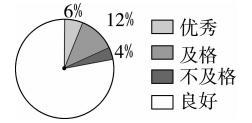

# Mathematics (Grade 6)

**ID**: e7b4b840
**难度**: hard
**题型**: short_answer

## 题目
五年级同学在9月份期间进行了一次数学测试，根据成绩分成四个等级（如下图所示）。

（1）优秀的人数占全班总人数的百分之几？不及格的人数占全班总人数的百分之几？
（2）如果总人数是200人，达到优秀的有多少人？比不及格的多多少人？
（3）这个班的及格率是多少？
（4）你还能提出什么问题？

## 解答

**答案**: 6%, 4%, 12, 4, 96%

1. Step1:观察扇形统计图，得出优秀的人数占全班总人数的6%
2. Step2:观察扇形统计图，得出不及格的人数占全班总人数的4%
3. Step3:已知总人数是200人，计算达到优秀的人数，200×6% = 12人
4. Step4:计算达到优秀的人数比不及格的多的人数，200×(6% - 4%) = 4人
5. Step5:计算及格率，1 - 4% = 96%

## 知识点

**知识点**:
  - 百分数应用题;扇形统计图的认识及绘制

---
