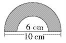

# Mathematics (Grade 6)

**ID**: e80d81cd
**难度**: hard
**题型**: short_answer

## 题目
求下面图形的周长和面积。（ 单位：cm）

## 解答

**答案**: 29.12, 25.12

1. Step1:根据圆的周长公式C = πd，计算外圆周长的一半，即3.14×10÷2 = 15.7厘米
2. Step2:根据圆的周长公式C = πd，计算内圆周长的一半，即3.14×6÷2 = 9.42厘米
3. Step3:计算两圆直径的差为10 - 6 = 4厘米
4. Step4:将外圆周长的一半、内圆周长的一半和两圆直径的差相加，得到图形的周长为15.7 + 9.42 + 4 = 29.12厘米
5. Step5:根据圆的面积公式S = πr²，计算外圆面积为3.14×(10÷2)² = 3.14×25平方厘米
6. Step6:根据圆的面积公式S = πr²，计算内圆面积为3.14×(6÷2)² = 3.14×9平方厘米
7. Step7:计算外圆面积与内圆面积的差为3.14×25 - 3.14×9 = 3.14×16平方厘米
8. Step8:将外圆面积与内圆面积的差除以2，得到图形的面积为3.14×16÷2 = 25.12平方厘米

## 知识点

**知识点**:
  - 圆的周长;圆环的面积

---
