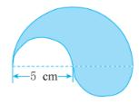

# Mathematics (Grade 6)

**ID**: ea00e689
**难度**: hard
**题型**: short_answer

## 题目
下面图形的周长是多少厘米？试着算一算。

## 解答

**答案**: 31.4

1. Step1:根据圆的周长公式C = 2πr（C为周长，r为半径），计算半径为5厘米的大圆的一半周长，即3.14×5×2÷2 = 15.7厘米
2. Step2:根据圆的周长公式C = πd（C为周长，d为直径），计算直径为5厘米的小圆的周长，即3.14×5 = 15.7厘米
3. Step3:将大圆的一半周长与小圆的周长相加，得到图形的周长，即15.7 + 15.7 = 31.4厘米

## 知识点

**知识点**:
  - 圆的周长

---
