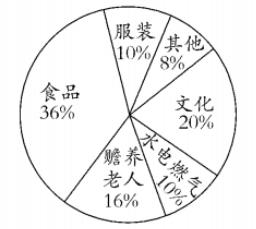

# Mathematics (Grade 6)

**ID**: eafb7829
**难度**: hard
**题型**: short_answer

## 题目
解决问题。
下面是聪聪家十月份各项生活支出情况统计图。

（1）这是（）统计图，从图中能获得哪些信息？
（2）如果聪聪家这个月的总支出是1600元，请你分别计算出各项支出。

## 解答

**答案**: 扇形统计图, 食品支出576元, 赡养老人支出256元, 水电燃气支出160元, 文化支出320元, 服装支出160元, 其它支出128元

1. Step1:观察统计图的特征，判断出这是扇形统计图
2. Step2:由图可知食品支出占总支出的36%，用总支出1600元乘以36%，即1600×36%=576元，得出食品支出为576元
3. Step3:由图可知赡养老人支出占总支出的16%，用总支出1600元乘以16%，即1600×16%=256元，得出赡养老人支出为256元
4. Step4:由图可知水电燃气支出占总支出的10%，用总支出1600元乘以10%，即1600×10%=160元，得出水电燃气支出为160元
5. Step5:由图可知文化支出占总支出的20%，用总支出1600元乘以20%，即1600×20%=320元，得出文化支出为320元
6. Step6:由图可知服装支出占总支出的10%，用总支出1600元乘以10%，即1600×10%=160元，得出服装支出为160元
7. Step7:由图可知其它支出占总支出的8%，用总支出1600元乘以8%，即1600×8%=128元，得出其它支出为128元

## 知识点

**知识点**:
  - 从统计图表中获取信息;扇形统计图的认识及绘制

---
