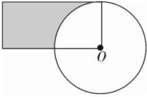

# Mathematics (Grade 6)

**ID**: f12fadce
**难度**: hard
**题型**: short_answer

## 题目
图中圆与长方形面积相等，长方形长9.42米，阴影部分的面积是多少平方米？

## 解答

**答案**: 21.195

1. Step1:设圆的半径为r米，根据圆面积公式圆的面积为3.14r²，且圆半径等于长方形的宽，由长方形和圆面积相等可得9.42r = 3.14r²
2. Step2:由9.42r = 3.14r²，两边同时除以r（r不为0），得到9.42 = 3.14r
3. Step3:计算r的值，r = 9.42÷3.14 = 3
4. Step4:计算圆的面积，3.14×3² = 28.26平方米
5. Step5:因为圆与长方形面积相等，所以阴影部分面积是圆面积的3/4，计算阴影部分面积，28.26×3/4 = 21.195平方米

## 知识点

**知识点**:
  - 圆的面积;长方形与正方形的面积

---
