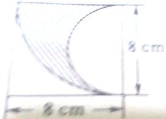

# Mathematics (Grade 6)

**ID**: f223d6ef
**难度**: hard
**题型**: short_answer

## 题目
求图中阴影部分的周长和面积．

## 解答

**答案**: 45.68, 25.12

1. Step1:根据圆的弧长公式$l = \frac{n}{180}×\pi×r$（$n$是圆心角度数，$r$是半径），半径为8厘米的$\frac{1}{4}$圆弧长为$\frac{90}{180}×3.14×8=\frac{1}{4}×2×3.14×8 = 12.56$厘米
2. Step2:直径为8厘米，则半径为4厘米，根据圆的弧长公式，直径为8厘米的$\frac{1}{2}$圆弧长为$\frac{180}{180}×3.14×4=\frac{1}{2}×3.14×8 = 12.56$厘米
3. Step3:计算阴影部分周长，将半径为8厘米$\frac{1}{4}$圆弧长、直径为8厘米$\frac{1}{2}$圆弧长和8厘米长线段相加，即$12.56 + 12.56 + 8 = 45.68$厘米
4. Step4:根据圆的面积公式$S = \pi×r^{2}$，半径为8厘米的$\frac{1}{4}$圆的面积为$\frac{1}{4}×3.14×8^{2} = 50.24$平方厘米
5. Step5:直径为8厘米，则半径为4厘米，直径为8厘米的$\frac{1}{2}$圆的面积为$\frac{1}{2}×3.14×4^{2}=\frac{1}{2}×3.14×（8÷2）^{2} = 25.12$平方厘米
6. Step6:计算阴影部分面积，用半径为8厘米$\frac{1}{4}$圆的面积减去直径为8厘米$\frac{1}{2}$圆的面积，即$50.24 - 25.12 = 25.12$平方厘米

## 知识点

**知识点**:
  - 组合图形的面积

---
