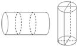

# Mathematics (Grade 6)

**ID**: f26c5829
**难度**: hard
**题型**: short_answer

## 题目
一个圆柱体木块，如果垂直于它的高切成三块小圆柱体，表面积增加50.24平方厘米；若沿上下底面圆心切成四块，表面积增加48平方厘米．现在把这个圆柱木块削成一个最大的圆锥体，削去部分的体积是多少立方厘米？

## 解答

**答案**: 50.24

1. Step1:根据垂直于高切成三块小圆柱体，表面积增加50.24平方厘米，可知增加了4个底面的面积，计算圆柱的底面积为50.24÷4=12.56平方厘米
2. Step2:由圆的面积公式S = πr²，根据底面积12.56平方厘米，计算半径r，r²=12.56÷3.14=4，因为2²=4，所以底面半径r = 2厘米
3. Step3:根据沿上下底面圆心切成四块，表面积增加48平方厘米，可知增加了2个以底面直径和高为边长的长方形，计算一个长方形的面积为48÷2=24平方厘米
4. Step4:已知半径为2厘米，得出直径为2×2 = 4厘米，根据长方形面积公式，计算圆柱的高为24÷4 = 6厘米
5. Step5:根据圆柱体积公式V = πr²h，计算圆柱体积为3.14×2²×6立方厘米
6. Step6:因为把圆柱削成最大圆锥，削去部分体积是圆柱体积的1 - 1/3 = 2/3，所以计算削去部分体积为3.14×2²×6×(1 - 1/3)=50.24立方厘米

## 知识点

**知识点**:
  - 简单的立方体切拼问题;圆柱的侧面积、表面积和体积;圆锥的体积．

---
