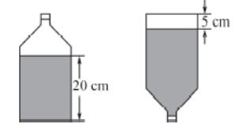

# Mathematics (Grade 6)

**ID**: f2f15c43
**难度**: hard
**题型**: short_answer

## 题目
有一种饮料瓶的瓶身呈圆柱形（ 不包括瓶颈），容积是30立方厘米。现在瓶中装有一些饮料，正放时饮料的高度是20厘米，倒放时空余部分的高度为5厘米，瓶内现有饮料多少立方厘米？

## 解答

**答案**: 24

1. Step1:设圆柱底面面积为S平方厘米，根据正放时饮料体积（20S）加上倒放时空余部分体积（5S）等于瓶子容积30立方厘米，列出方程20S + 5S = 30
2. Step2:化简方程20S + 5S = 30，得到25S = 30
3. Step3:求解方程25S = 30，得出S = 30÷25 = 6/5
4. Step4:根据圆柱体积公式，计算瓶内现有饮料体积为20×6/5 = 24立方厘米

## 知识点

**知识点**:
  - 圆柱的体积;测量不规则物体的体积

---
