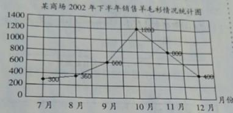

# Mathematics (Grade 6)

**ID**: fa3889e6
**难度**: hard
**题型**: short_answer

## 题目
某商场2002年下半年销售羊毛衫情况统计图

 （1）哪一个月比上一个月销售羊毛衫数量增长的最快？增长了百分之几？
 （2）这个商场下半年平均每月销售多少件羊毛衫？

## 解答

**答案**: 10月, 100%, 610

1. Step1:计算8月比7月销售羊毛衫数量的增长量，360 - 300 = 60(件)
2. Step2:计算9月比8月销售羊毛衫数量的增长量，600 - 360 = 240(件)
3. Step3:计算10月比9月销售羊毛衫数量的增长量，1200 - 600 = 600(件)
4. Step4:比较各月增长量600>240>60，得出10月比上一个月销售羊毛衫数量增长的最快
5. Step5:计算10月比9月增长的百分比，(1200 - 600)÷600 = 100%
6. Step6:计算下半年销售羊毛衫的总数，300 + 360 + 600 + 1200 + 800 + 400 = 3660(件)
7. Step7:计算下半年平均每月销售羊毛衫的数量，3660÷6 = 610(件)

## 知识点

**知识点**:
  - --

---
