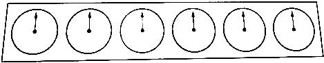

# Mathematics (Grade 6)

**ID**: fa84afc2
**难度**: hard
**题型**: short_answer

## 题目
游艺板上有6个可绕圆的中心自由旋转的圆形卡片，每张卡片上都标有向上的箭头（如图）．每次将其中任意5个卡片按顺时针方向旋转180°，至少要经过几次这样的旋转才能使它们的箭头全部向下？

## 解答

**答案**: 30

1. Step1:分析卡片旋转规律，因为每次顺时针旋转180°，所以同一张卡片转奇数次箭头朝下，转偶数次箭头朝上，要使6张卡片箭头都向下，每张卡片转动次数应为奇数次，那么6张卡片转动的总次数是6的倍数
2. Step2:考虑每次旋转5张卡片的情况，可知若干次旋转后，旋转的总次数是5的倍数
3. Step3:求5和6的最小公倍数，因为总次数既是5的倍数又是6的倍数，5和6互质，所以最小公倍数为5×6=30，即至少转30次
4. Step4:计算旋转次数，已知每次转5张卡片，总次数为30次，所以30÷5=6次，即至少要经过6次这样的旋转才能使箭头全部向下
5. Step5:根据题目所求为至少旋转的次数，答案为30

## 知识点

**知识点**:
  - 旋转

---
