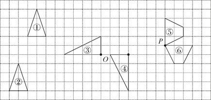

# Mathematics (Grade 6)

**ID**: fcf1d8e1
**难度**: hard
**题型**: short_answer

## 题目
观察方格纸中的图形，回答问题。

（1）图形①怎样变换可以得到图形②？
（2）图形③怎样变换可以得到图形④？
（3）图形⑤绕点P怎样变换可以得到图形⑥？

## 解答

**答案**: 图形①先向下平移6格，再向左平移2格得到图形②, 图形③先绕点O逆时针旋转90°，再向右平移3格得到图形④, 图形⑤绕点P顺时针旋转90°可以得到图形⑥

1. Step1:观察图形①和图形②的位置关系，发现图形①在图形②的右上角，根据方格纸中相距的格子数，确定图形①先向下平移6格，再向左平移2格可得到图形②
2. Step2:观察图形③和图形④，看到旋转中心为点O，对比图形③顺时针和逆时针旋转后的方向，得出只能绕点O逆时针旋转90°，再观察旋转后与图形④的位置，计算出再向右平移3格可得到图形④
3. Step3:观察图形⑤和图形⑥，对比图形⑤绕点P顺时针和逆时针旋转90°后的方向，确定图形⑤绕点P顺时针旋转90°可以得到图形⑥

## 知识点

**知识点**:
  - 小学数学;图形与几何;图形与变换;平移与平移现象;旋转三要素及旋转图形

---
