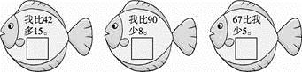

# Mathematics (Grade 6)

**ID**: 002bba5b
**难度**: medium_easy
**题型**: fill_in_the_blank

## 题目
给小鱼填上合适的数。

## 解答

**答案**: 57, 82, 72

1. Step1:计算比42多15的数，42 + 15 = 57
2. Step2:计算比90少8的数，90 - 8 = 82
3. Step3:计算67比哪个数少5，即这个数比67多5，67 + 5 = 72

## 知识点

**知识点**:
  - 

---
