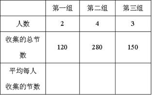

# Mathematics (Grade 6)

**ID**: 073ed729
**难度**: medium_easy
**题型**: fill_in_the_blank

## 题目
红星小学三年级某小队3个小组收集废电池的情况如下表：（从左往右填）

第________组平均每人收集的节数多。

## 解答

**答案**: 二

1. Step1:计算第一组平均每人收集的节数，用收集的总节数120除以人数2，即120÷2 = 60节
2. Step2:计算第二组平均每人收集的节数，用收集的总节数280除以人数4，即280÷4 = 70节
3. Step3:计算第三组平均每人收集的节数，用收集的总节数150除以人数3，即150÷3 = 50节
4. Step4:比较三组平均每人收集节数的大小，70＞60＞50，得出第二组平均每人收集的节数多

## 知识点

**知识点**:
  - 小学数学;统计和概率;统计;统计表;单式统计表的特点及填补;平均数、中位数、众数;平均数的意义及求法

---
