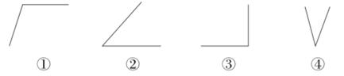

# Mathematics (Grade 6)

**ID**: 0b116793
**难度**: medium_easy
**题型**: fill_in_the_blank

## 题目
把下面的角按从大到小的顺序排列。

（______）＞（______）＞（______）＞（______）

## 解答

**答案**: ①, ③, ②, ④

1. Step1:明确需要比较角①、角②、角③、角④的大小
2. Step2:观察图形，角①是钝角，大于90度
3. Step3:角③是直角，等于90度
4. Step4:角②和角④是锐角，小于90度
5. Step5:进一步观察发现角②大于角④
6. Step6:所以从大到小的顺序为角①＞角③＞角②＞角④，对应为①＞③＞②＞④

## 知识点

**知识点**:
  - 小学数学;图形与几何;平面图形;角

---
