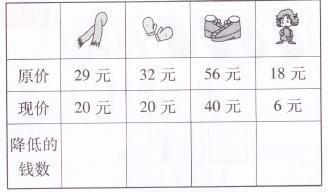

# Mathematics (Grade 6)

**ID**: 1b13fbec
**难度**: medium_easy
**题型**: fill_in_the_blank

## 题目
现价分别比原价降低了多少钱?填在表格内。

## 解答

**答案**: 9元, 12元, 16元, 12元

1. Step1:计算围巾降低的钱数，用围巾的原价29元减去现价20元，即29 - 20 = 9元
2. Step2:计算手套降低的钱数，用手套的原价32元减去现价20元，即32 - 20 = 12元
3. Step3:计算鞋子降低的钱数，用鞋子的原价56元减去现价40元，即56 - 40 = 16元
4. Step4:计算玩具降低的钱数，用玩具的原价18元减去现价6元，即18 - 6 = 12元

## 知识点

**知识点**:
  - 

---
