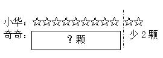

# Mathematics (Grade 6)

**ID**: 300b81bd
**难度**: medium_easy
**题型**: fill_in_the_blank

## 题目

奇奇有（______）颗。

## 解答

**答案**: 9

1. Step1:观察图形可知小华有11颗星星
2. Step2:因为奇奇比小华少2颗
3. Step3:所以奇奇有的星星数量为11 - 2 = 9颗

## 知识点

**知识点**:
  - 小学数学;数与代数;应用题;常见的数学问题;图文问题

---
