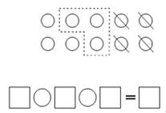

# Mathematics (Grade 6)

**ID**: 3b069da1
**难度**: medium_easy
**题型**: fill_in_the_blank

## 题目
看图列式计算

## 解答

**答案**: 10-3-4=3

1. Step1:观察图片可知，图中一共有10个圆圈
2. Step2:发现用斜线划掉了4个圆圈，表示减去4
3. Step3:又发现虚线框圈起来3个圆圈，也表示减去3
4. Step4:根据上述分析，列出算式10 - 3 - 4 = 3

## 知识点

**知识点**:
  - 小学数学;数与代数;数的运算;整数的四则运算;整数的加法、减法

---
