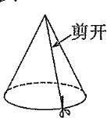

# Mathematics (Grade 6)

**ID**: 465469f9
**难度**: medium_easy
**题型**: fill_in_the_blank

## 题目
把圆锥的侧面按如图所示的方式剪开，然后将它展开想一想，它是一个什么图形？

## 解答

**答案**: 扇形

1. Step1:明确题目是询问将圆锥侧面按图示方式剪开并展开后是什么图形
2. Step2:依据圆锥的性质，其侧面展开图为扇形
3. Step3:得出答案为扇形

## 知识点

**知识点**:
  - 圆柱与圆锥;圆锥的认识

---
