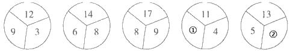

# Mathematics (Grade 6)

**ID**: 475ff243
**难度**: medium_easy
**题型**: fill_in_the_blank

## 题目
找规律填数．

①________  ②________

## 解答

**答案**: 7, 8

1. Step1:观察第一个圆中的数字，9 + 3 = 12；观察第二个圆中的数字，6 + 8 = 14；观察第三个圆中的数字，8 + 9 = 17，由此发现规律为圆中下方两个数字之和等于上方数字。
2. Step2:根据上述规律，对于第四个圆，因为上方数字是11，下方其中一个数字是4，所以11 - 4 = 7，故①处应填7。
3. Step3:对于第五个圆，上方数字是13，下方其中一个数字是5，所以13 - 5 = 8，故②处应填8。

## 知识点

**知识点**:
  - 小学数学;探索规律;图形的变化规律

---
