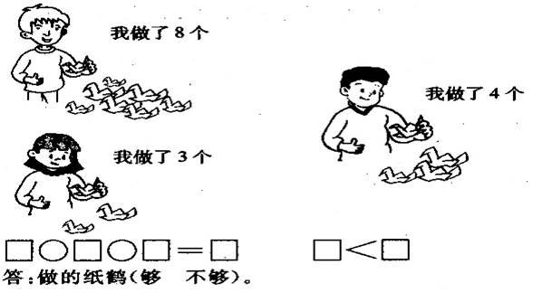

# Mathematics (Grade 6)

**ID**: 54a72423
**难度**: medium_easy
**题型**: fill_in_the_blank

## 题目
幼儿园中班有16个小朋友，送给每个小朋友一只纸鹤，够吗？你是怎样算的？

## 解答

**答案**: 不够

1. Step1:先计算出总共做的纸鹤数量，将三个小朋友做的纸鹤数相加，即8 + 3 + 4 = 15个
2. Step2:将总共做的纸鹤数量15个与小朋友的人数16个进行比较，得到15＜16
3. Step3:根据比较结果，因为15小于16，所以纸鹤数量不够

## 知识点

**知识点**:
  - 小学数学;数与代数;应用题;简单应用题;整数简单应用题

---
