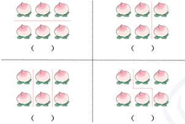

# Mathematics (Grade 6)

**ID**: 5691d018
**难度**: medium_easy
**题型**: fill_in_the_blank

## 题目

## 解答

**答案**: 第一、三幅图

1. Step1:观察图片，获取每幅图中桃子的分布情况
2. Step2:对比各幅图中桃子的分布，判断是否存在每一份桃子个数相同的情况
3. Step3:根据判断结果，确定属于平均分的图为第一、三幅图

## 知识点

**知识点**:
  - 小学数学;数与代数;数的运算;整数的四则运算

---
