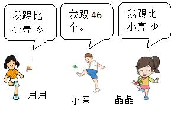

# Mathematics (Grade 6)

**ID**: 691da864
**难度**: medium_easy
**题型**: fill_in_the_blank

## 题目

月月最少踢（__________）个，晶晶最多踢（__________）个。

## 解答

**答案**: 47, 45

1. Step1:已知月月踢的比小亮多，小亮踢了46个，那么月月踢的个数大于46，大于46的最小整数是47，所以月月最少踢47个。
2. Step2:已知晶晶踢的比小亮少，小亮踢了46个，那么晶晶踢的个数小于46，小于46的最大整数是45，所以晶晶最多踢45个。

## 知识点

**知识点**:
  - 小学数学;数与代数;数的认识;整数的认识

---
