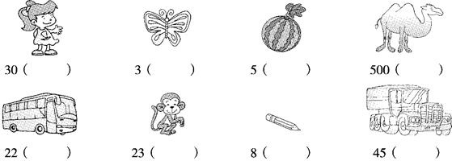

# Mathematics (Grade 6)

**ID**: 7c0276ef
**难度**: medium_easy
**题型**: fill_in_the_blank

## 题目
在(   )里填上合适的质量单位。

## 解答

**答案**: 千克, 克, 千克, 千克, 吨, 千克, 克, 吨

1. Step1:根据生活常识，一个小孩的体重大约是30千克
2. Step2:一只蝴蝶很轻，质量大约是3克
3. Step3:一个西瓜相对较重，质量大约是5千克
4. Step4:一只骆驼比较重，质量大约是500千克
5. Step5:一辆公共汽车非常重，质量大约是22吨
6. Step6:一只猴子的质量大约是23千克
7. Step7:一支铅笔很轻，质量大约是8克
8. Step8:一辆卡车非常重，质量大约是45吨

## 知识点

**知识点**:
  - 

---
