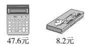

# Mathematics (Grade 6)

**ID**: 89c0475b
**难度**: medium_easy
**题型**: fill_in_the_blank

## 题目
买1个计算器和1个文具盒共需（____）元，文具盒比计算器便宜（____）元。

## 解答

**答案**: 55.8, 39.4

1. Step1:已知一个计算器价格是47.6元，一个文具盒价格是8.2元。
2. Step2:计算买1个计算器和1个文具盒共需的钱数，用加法，即47.6 + 8.2 = 55.8元。
3. Step3:计算文具盒比计算器便宜的钱数，用减法，即47.6 - 8.2 = 39.4元。

## 知识点

**知识点**:
  - 小学数学;数与代数;应用题;简单应用题;小数加法、减法应用题

---
