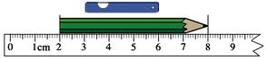

# Mathematics (Grade 6)

**ID**: 8d9d098f
**难度**: medium_easy
**题型**: fill_in_the_blank

## 题目

铅笔的长是（________）cm，小刀长（________）cm，铅笔比小刀长（________）cm。

## 解答

**答案**: 6, 3, 3

1. Step1:观察图片可知，铅笔从2cm刻度处开始，到8cm刻度处结束，其长度为8 - 2 = 6cm
2. Step2:小刀从2cm刻度处开始，到5cm刻度处结束，其长度为5 - 2 = 3cm
3. Step3:铅笔长度为6cm，小刀长度为3cm，所以铅笔比小刀长6 - 3 = 3cm

## 知识点

**知识点**:
  - 小学数学;图形与几何;测量;常见的长度单位及换算;长度的测量方法;长度及长度的常用单位

---
