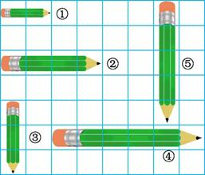

# Mathematics (Grade 6)

**ID**: 9535c217
**难度**: medium_easy
**题型**: fill_in_the_blank

## 题目
把下面几根铅笔按从长到短的顺序排一排。 

从长到短依次为____________________。

## 解答

**答案**: ④⑤②③①

1. Step1:观察图片中铅笔的长度
2. Step2:比较铅笔④和⑤的长度，发现④比⑤长
3. Step3:比较铅笔⑤和②的长度，发现⑤比②长
4. Step4:比较铅笔②和③的长度，发现②比③长
5. Step5:比较铅笔③和①的长度，发现③比①长
6. Step6:得出从长到短的顺序为④⑤②③①

## 知识点

**知识点**:
  - 小学数学;统计和概率;统计

---
