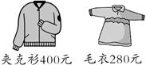

# Mathematics (Grade 6)

**ID**: a1c89324
**难度**: medium_easy
**题型**: fill_in_the_blank

## 题目
一件夹克衫和一件毛衣一共要（____）元；
一件夹克衫比一件毛衣贵（____）元。

## 解答

**答案**: 680, 120

1. Step1:已知夹克衫400元，毛衣280元，求一件夹克衫和一件毛衣一共的钱数，用加法，即400 + 280 = 680元
2. Step2:求一件夹克衫比一件毛衣贵的钱数，用减法，即400 - 280 = 120元

## 知识点

**知识点**:
  - 小学数学;数与代数;数的运算;整数的四则运算;整数的加法、减法

---
